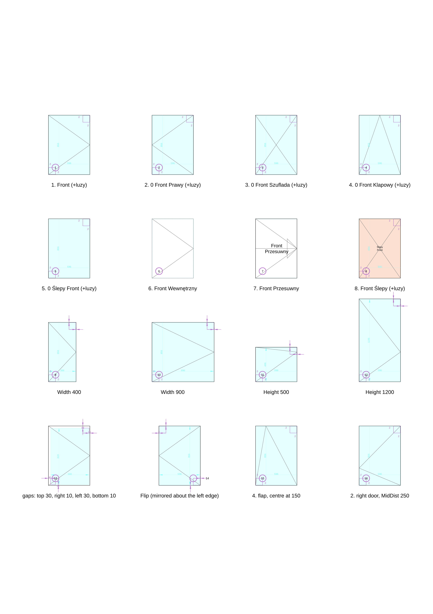

# Advisory: keeping a ZWCAD-style dynamic block live in CadCraft

**For:** whoever builds DWG dynamic-block support in CadCraft. That covers three areas:

- cc-dwg: `dwg/dynblock-read.js`
- the importer: `dwg-import.js`, `dyn-blocks.js`
- parametric blocks (PB.1): `lib/paramblock/paramblock.js`, `blockparams.js`

**Sample:** `Front_Parametryczny_03.dwg`, a parametric cabinet front.

- **Format:** DWG 2018.
- **Saved by:** an ODA-based program; its AppInfo names Teigha .NET.
- **Where to get it:** it is not in the repository. Ask the user for it.

**Build:** the CadCraft dev build's modules as served on 2026-11-25.

- They include the PB.1 fixes verified in `PARAMETRIC-BLOCKS-FIXES-VERIFY.md`.
- I ran them in Node 22 and drew the picture with CadCraft's own plotter.
- The lab token was not accepted, so the /lab shell was not used.

**Status:** advisory only. Nothing here is a pull request. Each claim is marked as one of:

- **measured:** run against the build
- **observed:** read from the file's bits, one sample
- **inferred**
- **proposal**

**Rule that applies throughout:** cc-dwg finds its layouts by experiment and has never read LibreDWG's source (the `dynblock-read.js` header). Everything in § 4 was found the same way, on this one file. Confirm it on more samples before relying on it.

---

## 0. Summary

- **Yes, CadCraft can keep this drawing's dynamic behaviour live.** I translated its definition into a PB.1 block (§ 5), and every behaviour works through the PB.1 engine:
  - all 8 visibility states
  - Width and Height
  - the four gaps
  - the hinge-marker height
  - the flap centre
  - the flip
  - the movable label

  The translation passes 32 checks (**measured**). It moves exactly the vertices the file says each action moves, 48 of 48. It reopens live from DXF 2000 and DWG 2000, 2010 and 2018.
- **Today CadCraft destroys this drawing's dynamic data.**
  - **Open and save:** this alone, in any DWG version or DXF, silently deletes the dynamic definition (81 objects) and 17 drawing objects: the 16 hidden ones and the attribute definition (§ 3.2, **measured**).
  - **INSERT › File:** it puts the front 236.8 km east and 74.4 km north of the pick point (§ 3.3, **measured**).
  
  Both fixes are small and should come first.
- **The visibility decoder fails on this file.** Every dynamic-block object in it carries element release 33; cc-dwg's samples carry 27. One prefix change makes cc-dwg's own decoder read it exactly (§ 4.2, **measured**). Other dynamic blocks saved by the same writer probably hit the same failure (**inferred**).
- **Order of work:**
  1. Stop the losses.
  2. Read the layouts in § 4 in cc-dwg.
  3. Translate to PB.1 on INSERT and in the Blocks panel, checking each reference against the file's own evaluated copy.
  4. Later, write edited references back so ZWCAD keeps them dynamic.

  PB.1 needs a few small additions (§ 6).

*The translated block at 16 settings, drawn by CadCraft's own plotter (`plot.js`: `modelSheet` → `displayList` → `toSvg`). Every layer is printed; three of the file's layers are screen-only. Row 1–2: the 8 visibility states. Row 3: Width 400 and 900, Height 500 and 1200. Row 4: gaps of 30, 10, 30 and 10 mm; the flip; the flap with its centre at 150; the right door with the marker at 250. In the flipped front (14), the number sits outside the front: gap G1.*

---

## 1. The drawing (observed)

The drawing's model space *is* the block definition. The dynamic data hangs on the `*Model_Space` record's extension dictionary (`ACAD_ENHANCEDBLOCK`), which is how a dynamic block is kept as one file per block: you save it from the block editor's "current drawing" or with WBLOCK, and inserting the file makes the block. cc-dwg already finds it (`readDynamic`, `dynblock-read.js:156`) and sets `*Model_Space.dynamic`.

- **30 objects in model space:**
  - 13 drawn
  - 16 hidden: the other visibility states
  - 1 attribute definition: `NUMER`, prompt `123`
- **81 dynamic-block objects:**
  - 1 evaluation graph
  - 12 parameters
  - 10 actions
  - 19 grips
  - 39 grip-location components
- **Insertion point:** the base-point parameter sits at the front's lower-left corner, (236788.0944, 74432.2456). The file's `INSBASE` is (0, 0).
- **Screen-only layers:** three layers do not plot (`plot: false`):
  - `Dodatkowe Niewidoczne` (helper squares, gap dimensions, a ⌀100 circle)
  - `Fronty - Niewidoczne` (the front panel and its hatch)
  - `Fronty - Wymiary` (the panel's size dimensions)

**Parameters.** Points are measured from the base point, in mm.

| Parameter | Kind | Label (description) | Value | Points |
|---|---|---|---|---|
| Liniowy | linear | Wysokość (height) | 860 | base (0, 860) → end (0, 0) |
| Liniowy1 | linear | Szerokość (width) | 600 | base (0, 0) → end (600, 0) |
| Liniowy2 | linear | Odległość3 (hinge-marker height) | 430 | base (600, 0) → end (600, 430) |
| Liniowy3 | linear | F. Góra Luz ("Ustawienie luzu na froncie na górze.") | 2 | base (497, 858) → end (497, 860) |
| Liniowy4 | linear | F. Prawa Luz (right gap) | 2 | base (598, 757) → end (600, 757) |
| Liniowy5 | linear | F. Lewa Luz (left gap) | 2 | base (2, 103) → end (0, 103) |
| Liniowy6 | linear | F. Dół Luz (bottom gap) | 2 | base (103, 2) → end (103, 0) |
| Liniowy7 | linear | Środek Klapy frontua (flap centre) | 300 | base (0, 860) → end (300, 860) |
| Odwracania | flip | Stan odwrócenia1: Nieodwrócony / Odwrócony | – | reflection line (0, 185.491) → (0, −674.509) |
| Punktowy | point | Położenie1 | – | (300, 430) |
| Punkt bazowy | base point | – | – | (0, 0) |
| Stan widoczności | visibility | Widoczność1, 8 states | – | grip at (0, −430) |

No parameter carries a value set (minimum, maximum, increment or list) that I could find. That needs a sample that has one.

**Actions.** The frame is the file's stretch frame, two corners measured from the base point.

| Action | Kind | Input (the point that moves) | Selected | Entities with vertex lists | Frame |
|---|---|---|---|---|---|
| Wysokość | stretch | Liniowy (base) | 25 (15 entities) | 14 | (−147.0, 592.0) – (842.9, 1134.2) |
| Szerokość | stretch | Liniowy1 (end) | 24 (21 entities) | 20 | (432.6, −299.8) – (892.4, 1068.4) |
| Rozciągania2 | stretch | Liniowy2 (end) | 8 | 8 | (−117.7, 294.3) – (669.8, 628.5) |
| Środek Klapy frontua | stretch | Liniowy7 (end) | 1 | 1 | (218.0, 785.0) – (365.4, 920.5) |
| F. Góra Luz | stretch | Liniowy3 (base) | 6 | 5 | (0.8, 856.1) – (599.4, 859.2) |
| F. Prawa Luz | stretch | Liniowy4 (base) | 7 | 5 | (592.1, 0.6) – (599.1, 858.9) |
| F. Lewa Luz | stretch | Liniowy5 (base) | 6 | 5 | (0.7, 1.1) – (4.3, 858.9) |
| F. Dół Luz | stretch | Liniowy6 (base) | 7 | 6 | (0.6, 0.9) – (599.2, 4.7) |
| Odwracania1 | flip | Odwracania | 49 (29 entities, the ATTDEF too) | – | – |
| Przesuwania | move | Punktowy | 2 (the "Ślepy Front" label and its grip) | – | – |

**Visibility states.** Each state lists the objects it shows and the "elements" it shows: the parameters, grips and actions present in that state. That is how the file switches actions off per state.

| # | State | Objects | Elements | Actions present besides height, width and flip |
|---|---|---|---|---|
| 1 | Front (+luzy) | 13 | 31 | hinge-marker height, the four gaps |
| 2 | 0 Front Prawy (+luzy) | 13 | 31 | the same |
| 3 | 0 Front Szuflada (+luzy) | 14 | 31 | the same |
| 4 | 0 Front Klapowy (+luzy) | 13 | 35 | the same, plus the flap centre |
| 5 | 0 Ślepy Front (+luzy) | 12 | 31 | hinge-marker height, the four gaps |
| 6 | Front Wewnętrzny | 4 | 15 | hinge-marker height |
| 7 | Front Przesuwny | 10 | 15 | hinge-marker height |
| 8 | Front Ślepy (+luzy) | 16 | 25 | the four gaps, the label's point |

---

## 2. What CadCraft already has (code reading)

- **cc-dwg** (`dwg/dynblock-read.js`):
  - It reads the evaluation graph's nodes, each parameter's and action's kind and name, and each reference's values. The values come from `ACAD_ENHANCEDBLOCKDATA` XRECORDs: distance, flip state, point and visibility state.
  - Its header says only the visibility parameter is decoded in full (`:20`).
  - Each layout carries a `Spec gap:` note and is accepted only when nothing is left over (`visibilityOf`, `:92`).
- **The importer** (`dyn-blocks.js`, DB.2–DB.9):
  - A named dynamic block keeps every file object, hidden ones too (`block.dyn.all`).
  - It can switch and edit visibility states.
  - It saves back dynamic in the version it came in.
  - Distances, flips and points show read only. The help page `app/help/dynamic-blocks.md` says so in "Not there yet".
- **PB.1**:
  - It has parameters with value sets.
  - Its actions are stretch, move, rotate, scale, mirror, array, polar, set, label and show, each with `keys` and `when`.
  - Grips are linear, angle, flip and list.
  - It has size tables and visibility states chosen by a formula.
  - Properties and grips edit it, and CadCraft's own records keep it in DXF and DWG.
- **The split.** `takesBp(blk) = !blk.dyn && !blk.xref` (`blockparams.js:46`): a block that came from a DWG with its own dynamic data cannot carry PB.1 data. The two systems are exclusive today.

---

## 3. What happens today with this file (measured; `t-dyn-today.mjs`)

### 3.1 Read

- cc-dwg finds the definition on `*Model_Space`: 12 parameters and 10 actions.
- `visibilityOf` throws `count 835907327`, so the 8 states are unreadable (§ 4.2).
- The importer handles dynamic definitions only for named blocks (`dwg-import.js:183`). The model space's hidden objects are dropped (`dwg-import.js:530`: `if (e.invisible) return null;`).
- **Open:** 13 objects, and the open report says nothing about a dynamic block.

### 3.2 Open, then save unchanged: the dynamic block is destroyed, silently

| Saved as | Objects | Hidden | Dynamic definition | Dynamic-block objects | Save notes |
|---|---|---|---|---|---|
| DWG 2018 | 13 | 0 | gone | 0 of 81 | none |
| DWG 2013 | 13 | 0 | gone | 0 of 81 | none |
| DWG 2000 | 13 | 0 | gone | 0 of 81 | the usual 2000 note only |
| DXF 2000 | – | – | gone | none | none |

The file loses 17 objects: the 16 hidden ones and the `NUMER` attribute definition. It also loses all of its dynamic behaviour. Picture a user who opens one of their library fronts in CadCraft, fixes a label and saves: the block is gone for good, with nothing said. The help page promises "Kept dynamic", which is true for named dynamic blocks but not for a drawing that is itself a block.

### 3.3 INSERT › File puts the front 237 km away

INSERT › File (whole drawing; `commands.js:3674` → `blockcopy.js` `planCopy`/`applyCopy`) gives the block `Front_Parametryczny_03`:

- 13 static objects
- base (0, 0), taken from `INSBASE`
- not parametric, no dynamic data

Placed at (0, 0), the front lands at x 236788.1…237388.1 and y 74432.2…75292.2. Dynamic-block programs take the base-point parameter as the insertion point (**inferred**; confirm in ZWCAD), which here is the front's corner.

This is the same code path as the open PB.1 finding: INSERT from a DXF or DWG file drops CadCraft's own parameters (`drawing.bparams`; `PARAMETRIC-BLOCKS-FIXES-VERIFY.md`, P2). Fix them together.

### 3.4 DXF 2000 breaks Polish layer names (general, not dynamic)

The R2000 and R12 writers escape non-ASCII as `\U+XXXX` (`dxf2000.js:26`, `dxf.js:1623`). The reader decodes those escapes in text but not in layer names (`dxf.js:223` for the layer table, `dxf.js:622` for each object's layer). A layer `Korpusy + półki + front` reopens as `Korpusy + p\U+00F3\U+0142ki + front`, and so does every object on it. DWG keeps the name. The fix is to decode group codes 2 and 8 the way text is decoded.

### 3.5 Other dynamic blocks from the same writer (inferred)

All 80 dynamic-block objects in this file carry element release 33, maintenance 248. cc-dwg's visibility layout was found on release-27 samples, and it does not parse release 33 (§ 4.2). Expect other dynamic blocks saved by the same writer, including named blocks with references, to lose their visibility states in CadCraft the same way. Test this with a ZWCAD drawing that contains references.

---

## 4. The layouts (observed on this file; `t-dyn-decode.mjs`)

All bit positions below are in an object's data stream after its handle. Strings come from the R2007+ string stream, as cc-dwg already reads them.

### 4.1 Element header

Every object starts with the same header:

1. BL −1
2. BL release: 33 here, 27 in cc-dwg's samples
3. BL maintenance: 248
4. BL (unknown)
5. the name, as the first string

This is exactly as `header()` reads it (`dynblock-read.js:61`). The release field is the switch for the layout differences below. Release 33 is probably the 2018 object format (**inferred**).

### 4.2 Visibility parameter: one change, then exact

From the grip point on, the layout is cc-dwg's own, field for field:

- BS, BS
- BL grip node: 33
- label, description
- B, B
- BL 29 objects + 29 handles
- BL 8 states, each with: name · BL objects + handles · BL elements + handles

It ends on the last bit (436) and uses all 338 handles.

The difference is before the grip point. Between the name (bit 88) and the grip point (BD3 at bit 106) there are 18 bits, and cc-dwg's `B B BS×4` does not parse them. Read as `B B B B BS BS BS` (one split that lands on bit 106; the values are not understood), the rest decodes with no bit, handle or string left. That is cc-dwg's own acceptance test. Given those states, the existing importer builds `dyn.vis` with all 8 states, unchanged (`dynBlockFromDwg`).

### 4.3 Parameters

- **Linear:**
  - Two BD3 at bits 114 (base) and 248 (end).
  - Strings: name, `DisplacementX`, `DisplacementY`, `DisplacementX`, `DisplacementY`, label, then the description if there is one.
  - Base and end are confirmed by the actions. Each stretch names `Base…Delta` or `End…Delta`, and that point lies on the edge the action stretches, every time.
- **Flip:**
  - BD3 at 106 and 240, the reflection line, plus one more BD3 at 400.
  - Strings: name, label, (empty), the two state names, `UpdatedFlip`.
- **Point:** BD3 at 106. Strings: name, `DisplacementX`, `DisplacementY`, label.
- **Base point:** three equal BD3 at 106, 246 and 380.

The fields between these points are not decoded. They include whatever holds a value set.

### 4.4 Actions: the wiring, in each action

After the header and the action's display point (a BD3, to bit 238):

- BL selected-object count
- BL dependent count
- BL dependent node × that count
- BL input node × 2

This gives every action's input parameter, so the graph's edge list (not yet read, `dynblock-read.js` `graphNodes`) is not needed for these kinds.

- **Dependents:** the other parameters and actions whose points the action carries along. Height carries the flap parameter and action, the flip and the top and right gaps. Width carries the top and right gaps and the hinge-marker parameter. In PB.1 terms, dependents decide where grips sit, not the shape.
- **Handle stream:** the selected objects come first, the count above. Then come the entities with vertex lists (§ 4.5).

### 4.5 Stretch action

After the input nodes:

- BL point count (2)
- RD x, RD y × points: the frame's two corners, raw doubles with no BD code
- BL entity count
- per entity: BL k, then BL vertex index × k
- BL 0
- BD 1 and BD 0, read as the distance multiplier and the angle offset (AutoCAD's defaults; **inferred**)
- 8 bits not understood

**Check (measured):** for all 48 polyline and line entries, the stored frame selects exactly the stored vertex indices on CadCraft's converted objects. That confirms the frame, the lists, and that CadCraft's converter keeps vertex order.

Dimensions carry their own index lists (0–4, the dimension's points). They are not mapped to CadCraft's `p1`/`p2`/`loc` yet. CadCraft's own frame rule gives the right measurements (§ 5).

### 4.6 Move and flip actions

They have selections only, no vertex lists. The flip selects all 29 entities, including the ATTDEF.

### 4.7 Associative hatches

No action lists either hatch in its vertex lists. Each one follows its boundary:

- `EB` (the panel) is bound to `EF`
- `135` is bound to `136`

cc-dwg already reads this as `loops[].boundary`. `EF`'s reactors also name three associative dimensions.

---

## 5. Proof: this drawing as a live PB.1 block (measured; `poc-front-pb.mjs`, `t-dyn-live.mjs`)

### 5.1 How the translation works

The existing importer does most of the work. Named like a block, the model space converts completely: 30 file objects with `dyn.all`, the hidden ones and the attribute. The translation then builds the following.

**Parameters**

- Each linear parameter becomes a `length` parameter. Its value is the base-to-end distance, and its label and description go in `note`.
- The flip becomes a `yesno` parameter.
- The point becomes two lengths, `MoveX` and `MoveY`.
- Visibility becomes a `count` parameter `State` (1–8).

**Visibility**

- One PB.1 visibility parameter with the 8 states, each `when` = its number and `expr: 'State'`.
- The objects come from the decoded state lists.

**Stretch actions**

- `delta = ±(P − P₀)` along the base→end direction of the point that moves.
- `keys` = the entities with vertex lists, plus the associative hatches bound to them (§ 4.7).
- `when` comes from the states' element lists:
  - the gaps: not in states 6 and 7
  - the flap: state 4 only
  - the hinge marker: not in state 8
- **Frames:**
  - Along the axis of travel, the frame is the file's own.
  - Across it, the frame is the file's extent widened by 10 m. That way a vertex an earlier action moved sideways stays inside the frame.
  - Actions run height and width first. A later action whose moving edge an earlier action moved shifts its frame by that delta: the top gap by the height change, the right gap by the width change.

**Other actions**

- The flip becomes `mirror` across the flip parameter's line, `when: 'Flip'`. Reading that line as the reflection line is **inferred**: it is a flip parameter's definition. The line runs along the left edge, so the flipped front lies left of its insertion point.
- Point plus move becomes `move` by (`MoveX`, `MoveY`) on the label, `when: 'State == 8'`.

**Grips and base**

- Grips: width, height, flip and the state list.
- The block's base is the base-point parameter.

### 5.2 Results

All of these pass (**measured**):

- **Default state:** exactly the 13 objects CadCraft draws today.
- **States:** each of the 8 states shows exactly the objects the file lists.
- **Width 800:** the outline is 800 × 860 and the panel 796 × 856, so the 2 mm gaps stay.
- **Height 1000, top gap 5, left gap 3:** the panel is 595 × 993 and sits 3 mm and 5 mm in from the edges.
- **Vertex check:** every action moves exactly the vertices the file stores for it (48 of 48), by the parameter's change.
- **Dimensions:** each gap's dimension measures the new gap, and the two size dimensions measure the new size.
- **Hatches:** both associative hatches keep filling their boundaries under every change tried.
- **Random sweep:** 320 random settings across all 8 states give finite numbers, the right objects, and panel = size − gaps.
- **Flip:** the front mirrors about the line, also after a stretch.
- **Label:** it follows the point in state 8 and ignores it elsewhere.
- **Grip drag:** dragging the width grip 100 mm sets Width = 700.
- **Save and reopen:** the block reopens live, with the reference's values, from DXF 2000 and from DWG 2000, 2010 and 2018.

DXF matches only after decoding the layer-name escapes from § 3.4. That issue fails separately, as the 33rd check.

**First-attempt lesson.** My first translation used frames I inferred myself, as the smallest band around each moving edge. The file's frames showed two of them were wrong:

- The height frame reaches 268 mm below the top, so the top-right helper square moves whole.
- The hinge-marker frame takes in the upper marker lines but not the lower ones.

Decode the frames; don't infer them.

---

## 6. What PB.1 needs

| # | Gap | Evidence | Proposal |
|---|---|---|---|
| G1 | Attributes don't follow actions. `geom.js:421` `attrTexts` places them at the ATTDEF's position. | With Flip = 1 the front spans x −700…100, but `NUMER` stays at x 102. The file's flip lists the ATTDEF. | Run the actions on attribute positions, treating an ATTDEF as an object with a key. |
| G2 | Stretch tests a frame on the shape as it stands. The file moves stored vertex lists, fixed when the block was made. | It matches here only through action order, widened frames and shifted frames. A different combination of frames could still diverge. | A stretch by vertex list: `{ t: 'stretch', pts: [[key, [i…]]…], dx, dy }`. This is exact, needs no frames, and changes in different actions add up as in the file. |
| G3 | No XY grip. | The point parameter has one. | `{ t: 'xy', px, py }`. Two linear grips stand in for now. |
| G4 | Grips and parameters can't be tied to a visibility state. Actions can, through `when`. | The file shows the flap's parameter and grip only in the flap state. | `when` on grips, and on whether Properties shows a parameter. |
| G5 | Parameter names are ASCII only: `NAME_RE = /^[A-Za-z_][A-Za-z0-9_]{0,39}$/` (`expr.js:61`). | "Szerokość" and "F. Góra Luz" are refused, so the translation uses `Width`, `GapTop`, … | A display `label` (any script) for Properties and grips. Formulas keep the ASCII name. |
| G6 | The frame tolerance is `1e-9 × the largest frame coordinate` (`paramblock.js:327`). | Frames left open with ±1e9 gave a 1 mm tolerance and swept in points 0.9 mm outside. | Base it on the block's extent, or document it. A translator must not open frames with huge numbers. |
| G7 | After a change, dimensions are redrawn by CadCraft's rules. The file's own dimension blocks are valid only at the saved values. | Arrows on the 2 mm gap dimensions move outside. | Cosmetic; no change needed. |
| G8 | `takesBp` makes DWG dynamic blocks and PB.1 exclusive (`blockparams.js:46`). | A translated block must drop `dyn`, which loses the round trip. | Decide below. |

**G8, the decision needed:** let one block carry both.

- `dyn` is the file's own data, kept for saving while the definition is unedited.
- `bp` is derived from it, with `bp.from = 'dwg'`, and does the drawing and editing.

Editing the definition in BEDIT drops `dyn`, as DB.9 already does for added or erased objects. Changing values on references keeps `dyn`.

---

## 7. Plan (proposal), with acceptance tests

**Stage 0: stop the losses (small; do first).**

1. Say on open that the model space is a dynamic block definition. The reader already knows (`*Model_Space.dynamic`).
2. Keep the model space's hidden objects (`dwg-import.js:530`). On a same-version DWG save, while the model space is unedited, pass the record's extension dictionary and the 81 objects through, as DB.2 does for named blocks. Otherwise warn before saving that it will become a plain drawing.
3. INSERT › File and the Blocks panel: use the base-point parameter as the block's base when the file has one, and fix the P2 remainder (`drawing.bparams`) on the same path.
4. Decode `\U+XXXX` in DXF layer names (§ 3.4).

*Accept when:* this file, opened and saved as DWG 2018, rereads with 30 objects in model space (16 hidden) and all 81 dynamic-block objects, and ZWCAD opens it as the same block (manual). INSERT at (0, 0) puts the corner at (0, 0).

**Stage 1: read (cc-dwg).**

1. The release-33 visibility prefix (§ 4.2).
2. Linear, flip, point and base-point geometry and strings (§ 4.3).
3. Action wiring (§ 4.4).
4. Stretch frames, vertex lists, multiplier and angle offset (§ 4.5).
5. Move and flip selections (§ 4.6).
6. Value sets, once a sample has them.

Find each by the existing method, one feature per sample, from both ZWCAD and AutoCAD, so release 27 and release 33 are both covered. Mark an object `undecoded` whenever bits, handles or strings are left over, and never throw.

*Accept when:* every object in a sample set decodes with nothing left over, except fields documented as not understood (the stretch action's last 8 bits today).

**Stage 2: make it live (translate to PB.1).**

1. A DOM-free `dyn-to-pb.js` next to `dyn-blocks.js`. It takes a definition and its converted objects and returns `{ bp, report }`. The report lists every parameter and action as translated, approximated or dropped.
2. Use it on INSERT › File, in the Blocks panel's libraries, for named dynamic blocks in an opened drawing (replacing the read-only Custom values), and when the user asks to open a drawing like this one as a block.
3. Each reference's decoded values (`insert.dyn.values`) become `insert.bp.vals`.
4. **Self-check every reference.** A drawing saved at non-default values carries ZWCAD's own evaluated copy of each reference (the anonymous block, `block.dynamicOf`). Compare PB.1's shape at the decoded values with that copy. Where they differ, keep the file's copy, mark the reference read only, and say so.

   With this check, a wrong translation can never silently change a drawing.

*Accept when:* `t-dyn-live.mjs`'s checks pass on this file, and the self-check passes on ZWCAD drawings that hold references at non-default values in every state.

**Stage 3: write back (later).** Save references edited in CadCraft so ZWCAD opens them still dynamic and at the new values: the values XRECORDs plus the evaluated anonymous copy, with the definition passed through. Until then, the save report says these references are saved as drawn, with CadCraft's own records.

---

## 8. To settle in ZWCAD (not testable here)

1. Does it insert this file at the base-point parameter?
2. Does the flip mirror the front about its left edge, as the parameter's line says?
3. Does a ZWCAD drawing with references to a named dynamic block also write release 33, and does cc-dwg then lose its states (§ 3.5)?
4. What do the stretch action's last 8 bits and the 18-bit visibility prefix hold? Vary one property at a time and compare.
5. How are value sets (minimum, maximum, increment, list) stored? Look-up, XY, rotation, polar and array parameters and actions need samples too.

---

## 9. Files

`docs/reviews/dynamic-blocks-tests/` holds the files listed below. Its `README.md` explains how to rerun them; `t-dyn-live.mjs` and `t-dyn-sheet.mjs` load the translation from `poc-front-pb.mjs`.

| File | What it does |
|---|---|
| `t-dyn-today.mjs` | § 3, measured today |
| `t-dyn-decode.mjs` | § 4: the layouts and their exactness checks |
| `poc-front-pb.mjs` | § 5: the proof-of-concept translation, which the next two scripts load |
| `t-dyn-live.mjs` | the 33 checks plus the gap notes |
| `t-dyn-sheet.mjs`, `render-sheet.cjs` | the picture |
| `lib-*.mjs` | observation helpers on CadCraft's own bit reader |

They need a mirror of the dev build and the sample DWG; neither is in the repository.

— Codie
