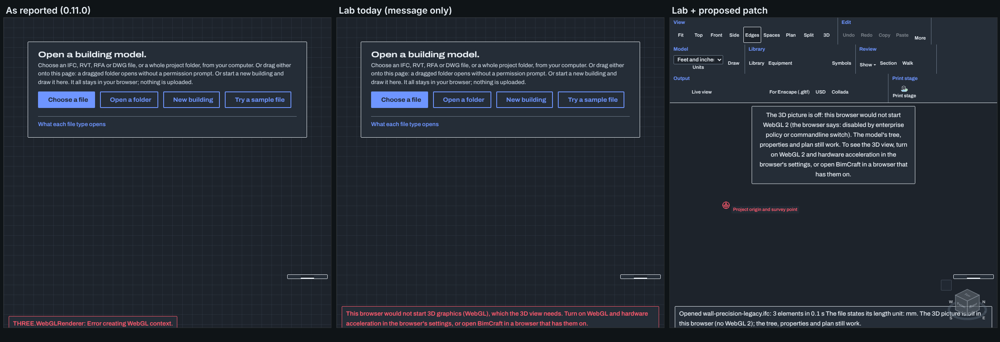

# Bug: "THREE.WebGLRenderer: Error creating WebGL context." when opening an IFC in BimCraft Lab

**Date:** 2026-11-26. **Status:** triage and a proposed patch. Nothing was pushed to a BimCraft repository, and no pull request was opened.

**Report:** any IFC file, BimCraft Lab on the web, red message at the bottom of the stage ("THREE.WebGLRenderer: Error creating WebGL context."). Richard's reply was a browser checklist (about:support, about:config, hardware acceleration, extensions, compare with Chrome or Edge). The owner's view: the issue is with BimCraft.

**What was tested:** the lab build's own files, run in Chromium 158 through the repository's dev shell (`withshalom/getbimcraft`, which serves the app from a clone with no sign-in). Where the lab differs from the repository (it is ahead of the 0.11.0 release), the lab's served files were used. See § 8 for what that does and does not cover.

---

## 1. Verdict

**Both of you are right, about different things.**

- **The trigger is outside BimCraft.** The wording of the message proves the browser would not give BimCraft any WebGL 2 context, not even a plain one (§ 2). BimCraft's own settings cannot cause this particular message. So Richard's checklist is the right place to look. I reproduced the exact message with WebGL really switched off in the browser (§ 3).
- **How BimCraft fails is BimCraft's bug.** Without WebGL 2, no IFC opens at all, and the screen is left half switched (§ 4). The same app, given a DWG in the same browser, carries on in 2D and says so. Today's lab build already shows a friendlier message, in English only. It changes the words, not the outcome.

**A small patch fixes the outcome.** It makes the IFC open without the 3D picture and says why. On the three builds I compared (the release as reported, the lab as of today, the lab plus the patch), a 14-check suite passes 2, 2 and 14. The patch is +49 / −4 lines across four files (§ 6).

| Browser | As reported (0.11.0) | Lab today (message only) | Lab + patch |
|---|---|---|---|
| WebGL on | opens | opens | opens |
| WebGL really off | red "THREE.WebGLRenderer: Error creating WebGL context."; nothing opens | red "This browser would not start 3D graphics (WebGL)…"; nothing opens | **opens**; notice and status line say the 3D picture is off; tree, properties and plan work |
| WebGL 1 on, WebGL 2 off | same as above | same message, though WebGL is on | **opens**, as above |



*Dark theme, WebGL off. Left: as reported. Middle: the lab today. Right: with the patch (the notice, and the model open behind it). The light-theme sheet is `bimcraft-no-webgl/sheet-paper.png`.*

---

## 2. Reading the message

The renderer's constructor in the vendored three.js (r186; `three.module.js:16446–16458`):

```js
const contextName = 'webgl2';
_gl = getContext( contextName, contextAttributes );        // BimCraft's attributes
if ( _gl === null ) {
    if ( getContext( contextName ) ) throw new Error( 'THREE.WebGLRenderer: Error creating WebGL context with your selected attributes.' );
    else                             throw new Error( 'THREE.WebGLRenderer: Error creating WebGL context.' );
}
```

| Message | Meaning |
|---|---|
| "…context **with your selected attributes**." | A plain WebGL 2 context works; BimCraft's settings (`antialias`, `stencil`, `preserveDrawingBuffer`, …) made it fail. |
| "…context." (**the report**) | A plain WebGL 2 context failed too. The browser has no WebGL 2 to give this canvas. |

Two consequences:

1. **BimCraft's attributes are not the cause here.** `viewer3d.js:67` asks for `{ antialias: true, preserveDrawingBuffer: true, stencil: true }`: no `failIfMajorPerformanceCaveat`, nothing exotic.
2. **BimCraft needs WebGL 2, not WebGL.** r186 asks only for `'webgl2'`. A browser or GPU with WebGL 1 only fails here, and a WebGL 1 test page would pass.

**Why "any IFC" and nothing earlier:** the 3D viewer is created lazily. The app loads fine; the first IFC open runs `ensureViewer()` (`ifc-open-ui.js`), which builds `Viewer3D` and its renderer for the first time.

**A second place the reason is, and the screen hides it:** three.js logs the browser's own reason just before the error: "THREE.WebGLRenderer: A WebGL context could not be created. Reason: …". With `--disable-3d-apis`, Chromium's reason is "disabled by enterprise policy or commandline switch". Other browsers word theirs differently. This console line is the most useful thing to get from the reporter.

---

## 3. Reproduction

Chromium 158 in this container creates WebGL 2 in software (SwiftShader), so it works as a control. The three conditions:

- **WebGL on.**
- **WebGL really off:** `--disable-3d-apis`. To the page, no WebGL context can be created, the way a privacy build with WebGL disabled behaves.
- **WebGL 1 on, WebGL 2 off:** simulated by making `getContext('webgl2')` return `null` and fire `webglcontextcreationerror`. This is `webgl.enable-webgl2 = false`, or an older GPU.

Results, opening two IFC files in a row in each condition:

| Build | WebGL on | WebGL really off | WebGL 2 off |
|---|---|---|---|
| As reported (0.11.0) | opens | **fails: raw three.js line** | **fails: raw three.js line** |
| Lab today (2026-11-26) | opens | **fails: friendlier line** | **fails: friendlier line** |
| Lab + patch | opens | opens | opens |

The raw line in the first row is the report's, in the same red box, bottom left of the stage.

---

## 4. What BimCraft does wrong (evidence in the repository)

| # | Defect | Evidence |
|---|---|---|
| B1 | **All or nothing.** Without WebGL 2 the IFC is not opened at all: no tree, no properties, no plan, although reading the IFC (web-ifc, WebAssembly) needs no GPU: with the patch the same files read and fill those panels. | v0 and v1 above. `ifc-open-ui.js` starts the IFC engine, then `ensureViewer()` throws and the open is abandoned. |
| B2 | **It is inconsistent with its own DWG path.** A DWG opened with WebGL off shows "This browser could not start the 3D view, so the drawing is shown in 2D." (`dwg3d.fallback`, `dwg-open-ui.js:159`) and carries on. The IFC path has no equivalent. | Measured: with WebGL off the DWG fixture opens in 2D, not as an error. |
| B3 | **The raw three.js line was the message.** The lab changed this today (`ifc-open-ui.js`, comment dated 2026-11-26: it catches the error and shows `view3d.nowebgl`). English only: German, French and Polish fall back to English (I could not check other languages). | The lab's `lang/en.json` has the key; `de`, `fr` and `pl` do not. |
| B4 | **The message says "WebGL" but the need is WebGL 2.** "Turn on WebGL and hardware acceleration" is misleading on a machine where WebGL 1 works. | Measured in the WebGL 2 off condition: the lab's message appears with WebGL 1 on. |
| B5 | **A failed open leaves the stage half switched.** `ensureViewer()` unhides the 3D area before building the viewer; when that throws, the 3D area stays shown and the "Open a building model" card stays up. | `wrapHidden=false` and `emptyHidden=false` after the failure, in v0 and v1. |
| B6 | **The browser's reason is only in the console.** | § 2. |
| B7 | **No test covers it.** `tests/bin` runs in Node, with no browser, so nothing opens a model without WebGL. | `nogl-check.cjs` (§ 6) is one. |

---

## 5. Richard's checklist, against this message

| His point | Verdict for this error |
|---|---|
| about:support: "WebGL 1 Driver Renderer" and "WebGL 2 Driver Renderer" | **Right. Read both lines.** BimCraft needs the WebGL 2 one. "Blocked" or "unavailable" there is the cause. |
| get.webgl.org | **Not enough.** As I remember it, that page tests WebGL 1 and WebGL 2 has its own page (I could not load either from here). A pass on WebGL 1 does not clear BimCraft. |
| `webgl.disabled` false | Consistent with the message. Privacy builds often ship it on (LibreWolf is the usual example; I could not check its current default from here). |
| `webgl.enable-webgl2` true | **The most telling one:** `false` gives exactly "WebGL 1 works, BimCraft fails". |
| `webgl.force-enabled` | Plausible when a driver blocklist is the cause. Not testable here. |
| `privacy.resistFingerprinting` | Plausible. Not testable here. |
| Hardware acceleration and driver blocklists | Plausible, especially on Linux and in VMs. Note that Chromium here made WebGL 2 in software; a missing GPU alone is not always fatal. |
| CanvasBlocker, Trace | Plausible: they interfere with canvas and WebGL contexts. Not testable here. |
| Compare with stock Chrome or Edge | **Yes, the best single test.** If BimCraft opens there, it is the reporter's browser. |
| *Missing from the list* | **The console line before the error** (§ 2): it names the browser's reason. Ask for it. |
| "Use lab access. I haven't rotated codes yet." | See § 8. |

None of this fixes BimCraft's behaviour; it only finds the reporter's cause. That is why the patch matters: the reporter should not have to reconfigure a browser to read a model's properties.

---

## 6. The patch

`bimcraft-no-webgl/bimcraft-no-webgl.patch`, against the lab files as served. It builds on today's lab change; it does not replace it.

| File | Change |
|---|---|
| `viewer3d.js` (+21 −2) | `Viewer3D` takes an opt-in, `allowNoGL`. When the renderer cannot be made, it listens for the browser's reason (`webglcontextcreationerror`), uses a renderer that **draws nothing**, and sets `viewer.noGL` to the reason (capped at 160 characters). The stub answers the five renderer members the viewer uses and the ones the point-cloud picker calls. Without the opt-in, nothing changes. |
| `ifc-open-ui.js` (+8 −2) | The IFC path passes `allowNoGL: true`. When `noGL` is set, one notice goes on the 3D area and the final "Opened …" status line says the 3D picture is off. |
| `bimcraft.css` (+18) | `.bc-nogl`, on the status box's own theme variables, so paper and model space both read. |
| `lang/en.json` (+2) | `view3d.nogl` ("…turn on WebGL 2…", with `{why}`) and `view3d.nogl.short`. |

**Why the opt-in:** the family editor's preview also builds a `Viewer3D`, inside a `try/catch` that shows "no preview" on failure. If the constructor stopped throwing for everyone, that message would turn into a blank canvas. Only the main IFC view asks for data-only mode.

**Why it is small:** `ST.viewer` is used in 450 places, but `Viewer3D` itself reaches the GPU through only five renderer members (`render`, `setSize`, `setPixelRatio`, `localClippingEnabled`, `clippingPlanes`). The scene, the picking, the visibility and the model data are CPU-side three.js objects. Nothing needs to be drawn to keep them working.

**What it does not do:**

- It does not make 3D appear. Nothing is drawn without WebGL 2.
- It does not add an early warning at start-up. With the patch, the first IFC open shows the notice.
- It does not touch `viewimage.js` (a shared library kept byte-identical across the apps). Nothing in BimCraft calls it.

### Results

| Check | Result |
|---|---|
| `nogl-check.cjs`, 14 checks, 3 conditions | unpatched release **2 of 14**, lab today **2 of 14** (the control and "no uncaught errors"), lab + patch **14 of 14** |
| Matrix of all three builds (16 checks on the patched one) | all pass, repeated after each edit |
| Patched, WebGL off, two files in a row | both open; one notice, however many files |
| Tree, element properties, 2D plan | **same with WebGL on and off** (4 / 4 / 4 nodes; plan 974 / 974 / 974 line pixels) |
| `smoke-buttons.cjs`: all 50 toolbar buttons, WebGL on vs off | **0 differing outcomes**, 0 uncaught errors in either (VR gives its own "No VR headset found" in both) |
| Opt-in contract | a plain `new Viewer3D(canvas)` still throws without WebGL 2 (the family editor relies on that); with WebGL on both forms make a real renderer |
| Patch applies to the lab as served | `patch --dry-run` and for real: no offsets, no fuzz; patched files equal "lab + my additions"; nothing of the lab's removed from the stylesheet or strings |
| The repository's own `test-bimcraft.mjs` (Node) | passes (91 files opened, 13 partial-mode checks). It covers IFC reading, not the viewer. |

My own first check caught one problem worth knowing: building the patch by diffing the lab's stylesheet against the 0.11.0 repository would have deleted six lab-only lines (parametric-block rules). The patch is therefore built from the lab's file plus only my additions.

### Not tested

- Real Firefox, Safari or a real GPU. The `statusMessage` text in Firefox and Safari is unknown to me.
- Saving or printing the 3D picture, Live view, VR and WebXR beyond clicking their buttons, opening a point cloud (the stub covers what the picker calls, but I did not load a cloud), schedules and checks.
- Any language but English.
- The sibling apps. PartCraft, ModelCraft and CadCraft use three.js too; I did not look at how they create their renderers.

---

## 7. What to do

**Now, for the reporter:**

1. Ask for the console line before the error (F12 → Console): "A WebGL context could not be created. Reason: …".
2. In Firefox, the two lines in about:support: "WebGL 1 Driver Renderer" and "WebGL 2 Driver Renderer".
3. The browser, its version and whether it is a fork, and whether BimCraft opens a model in plain Chrome or Edge.
4. Meanwhile: `webgl.disabled` false and `webgl.enable-webgl2` true in about:config, hardware acceleration on, canvas or WebGL blocking extensions off, then reload.

**In BimCraft, in order:**

1. Ship the patch (or at least `viewer3d.js` and `ifc-open-ui.js`).
2. Translate `view3d.nowebgl`, `view3d.nogl` and `view3d.nogl.short`. The first one still says "WebGL"; with the patch it is only a fallback for other callers, and it should say WebGL 2 too.
3. Put `nogl-check.cjs` into the browser checks that run before a release.
4. Say WebGL 2 in the help's system requirements; today the page says "needs JavaScript and WebGL" (`ui.noscript`).
5. Decide whether an early warning at start-up is wanted. The app already has two WebGL 2 probes, `webglInfo()` in `render/render-core.js` and the compute probe, which could drive one.
6. Look at the sibling apps (see "Not tested").

**Draft reply to the reporter** (edit before sending; the last sentence promises a change nobody has agreed yet):

> Thanks for the report. "Error creating WebGL context" means your browser did not give BimCraft a WebGL 2 context at all; it is not about the file. BimCraft's 3D view needs WebGL 2, and a test page that only checks WebGL 1 can pass while BimCraft fails.
>
> Could you send us: (1) the console line just before the error (press F12, open Console; it starts "A WebGL context could not be created. Reason:"); (2) in Firefox, the "WebGL 1 Driver Renderer" and "WebGL 2 Driver Renderer" lines from about:support; (3) your browser and version, and whether BimCraft opens a model in plain Chrome or Edge.
>
> Meanwhile, in about:config check that `webgl.disabled` is false and `webgl.enable-webgl2` is true, turn hardware acceleration on, and turn off extensions that block canvas or WebGL, then reload. We are also changing BimCraft so that, without WebGL 2, the model still opens (tree, properties, plan) and tells you why, instead of stopping.

---

## 8. Limits of this work, and lab access

- **I did not sign in to the lab.** `/lab/bimcraft` redirects to `/login`, which is an email-and-password account form (`POST /api/auth/login`). There is no field for a lab code, so the code cannot be entered there, and I do not have an account. I did not use or print the code.
- **I ran the lab's code instead.** The pre-release build's files are served without signing in at `/assets/apps/bimcraft/dev/`: only the lab *page* is gated. The same was true of CadCraft's dev build earlier in this session. If that is not intended, it is worth knowing.
- **The repository is at 0.11.0; the lab is ahead.** I took the lab's served `viewer3d.js`, `ifc-open-ui.js`, `bimcraft.css` and `lang/en.json` as the base. `viewer3d.js` is identical in both. The lab's `ifc-open-ui.js` and stylesheet differ by a few lines (the 2026-11-26 message fix; parametric-block rules). The rest of the app in my runs is the repository's 0.11.0.
- **Chromium only, headless**, with software WebGL as the control. No real GPU, Firefox or Safari.
- **Two facts come from memory,** because this session's network could not reach `get.webgl.org` or `librewolf.net`: what get.webgl.org tests, and LibreWolf's WebGL default. Both are marked where used. I did not try to get around the block.
- **The lab code is still in this session's earlier messages**, as the owner said it has not been rotated. Rotate it when convenient.

— Codie

---

## Files

`docs/reviews/bimcraft-no-webgl/`:

| File | What it is |
|---|---|
| `bimcraft-no-webgl.patch` | the proposed change, against the lab as served |
| `nogl-check.cjs` | the 14-check suite, any served build |
| `smoke-buttons.cjs` | every toolbar button, WebGL on vs off |
| `sheet-model.png`, `sheet-paper.png` | the three builds side by side, dark and light |
| `README.md` | how to run them; limits |
